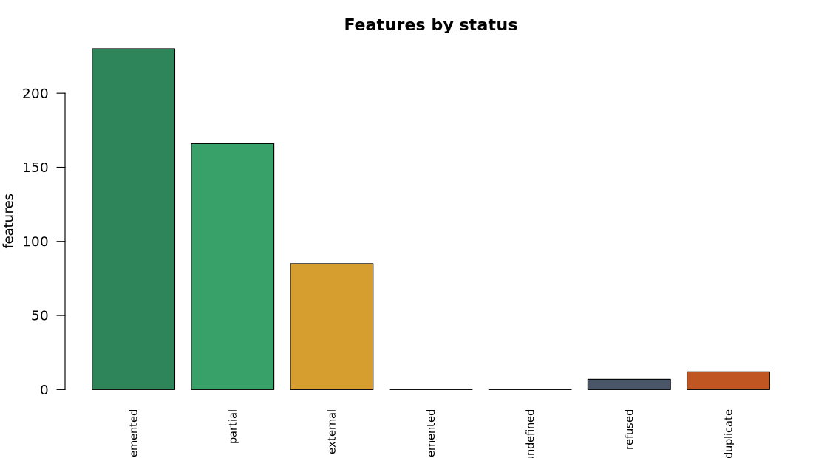
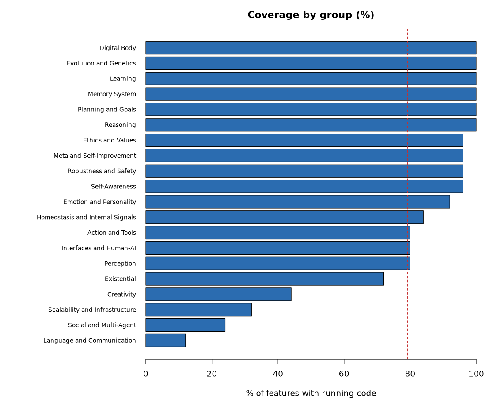
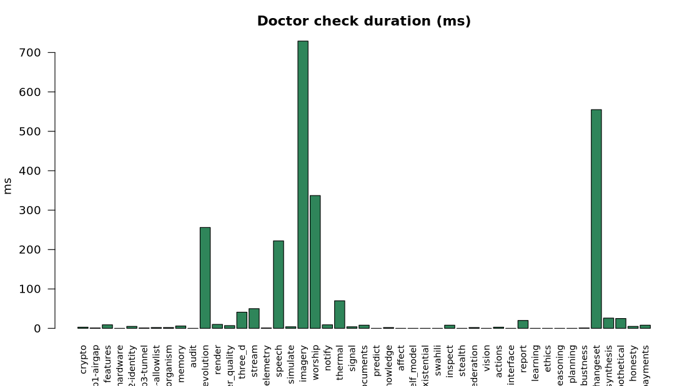
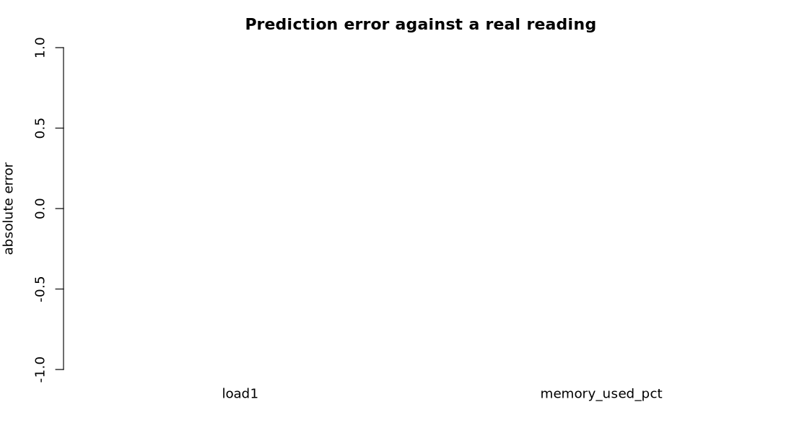
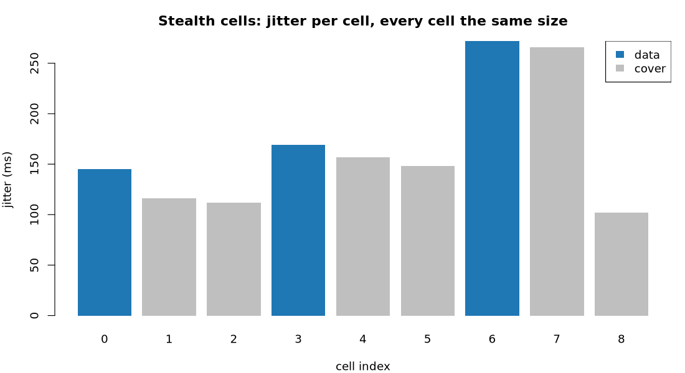

# OmniShield analysis report

Generated 2026-11-21 15:22:17 UTC by `analysis/report.R` from data produced by `omnishield export`. Every number below comes from the running system.

## Headline

| metric | value |
|---|---|
| Features in the ledger | 500 |
| Built (implemented + partial) | 396 |
| Coverage | 79.2% |
| Components healthy | 46 / 46 |
| Doctor checks passed | 47 / 47 |
| Doctor wall time | 2432 ms |

## Feature coverage

| status | features |
|---|---|
| implemented | 230 |
| partial | 166 |
| external | 85 |
| not_implemented | 0 |
| undefined | 0 |
| refused | 7 |
| duplicate | 12 |

### Coverage by group

| group | features | built | coverage_pct |
|---|---|---|---|
| Digital Body | 25 | 25 | 100 |
| Evolution and Genetics | 25 | 25 | 100 |
| Learning | 25 | 25 | 100 |
| Memory System | 25 | 25 | 100 |
| Planning and Goals | 25 | 25 | 100 |
| Reasoning | 25 | 25 | 100 |
| Ethics and Values | 25 | 24 | 96 |
| Meta and Self-Improvement | 25 | 24 | 96 |
| Robustness and Safety | 25 | 24 | 96 |
| Self-Awareness | 25 | 24 | 96 |
| Emotion and Personality | 25 | 23 | 92 |
| Homeostasis and Internal Signals | 25 | 21 | 84 |
| Action and Tools | 25 | 20 | 80 |
| Interfaces and Human-AI | 25 | 20 | 80 |
| Perception | 25 | 20 | 80 |
| Existential | 25 | 18 | 72 |
| Creativity | 25 | 11 | 44 |
| Scalability and Infrastructure | 25 | 8 | 32 |
| Social and Multi-Agent | 25 | 6 | 24 |
| Language and Communication | 25 | 3 | 12 |

## Components

| name | layer | ok | evidence |
|---|---|---|---|
| P1 strict air-gap | transport | true | omnishield/p1_airgap.py::sign_profile |
| P2 hardware-rooted identity | identity | true | omnishield/p2_identity.py::verify_response |
| P3 ephemeral tunnel | transport | true | omnishield/p3_tunnel.py::client_handshake |
| P4 deterministic allow-list | application | true | omnishield/p4_allowlist.py::AllowList::load_module |
| Hybrid signatures | crypto | true | omnishield/hybrid.py::HybridSigner::sign |
| ORGANISM core | runtime | true | organism/src/rpc.rs::discover |
| Durable memory | runtime | true | omnishield/memory_store.py::PersistentMemory::verify |
| Fail-closed guards | runtime | true | organism/src/guard.rs::CircuitBreaker::record |
| Audit chain | integrity | true | omnishield/audit.py::AuditLog::verify |
| Hardware binding | identity | true | omnishield/device.py::require_tpm |
| Gated self-modification | meta | true | omnishield/evolution.py::apply |
| Reasoning engines | cognition | true | omnishield/reasoning.py::deduce |
| Planning engines | cognition | true | omnishield/planning.py::plan |
| Files and processes | introspection | true | omnishield/inspect.py::read_file |
| Stealth transport | network | true | omnishield/stealth.py::StealthChannel |
| Federation and devices | network | true | omnishield/federation.py::seal_message |
| Vision and audio | perception | true | omnishield/vision.py::decode_png |
| Action and tools | action | true | omnishield/actions.py::compose |
| Human interface | interface | true | omnishield/interface.py::Personalizer::update |
| CPU renderer and animation | media | true | omnishield/render.py::Canvas |
| Waveform collection and cleaning | perception | true | omnishield/signal.py::clean |
| Office and PDF writer | interface | true | omnishield/docgen.py::report |
| Chunked and parallel data transfer | runtime | true | omnishield/stream.py::chunked_copy |
| Air telemetry window and alerts | perception | true | omnishield/stream.py::Telemetry |
| Keyword spotting and formant speech | interface | true | omnishield/speech.py::KeywordSpotter |
| 3D ray tracer and orbit | media | true | omnishield/three_d.py::scene3d |
| Physics simulator | reasoning | true | omnishield/three_d.py::simulate_pendulum |
| Daily image learning | perception | true | omnishield/imagery.py::daily |
| Daily office of prayer and song | spirit | true | omnishield/worship.py::daily |
| Consent-based daily notification | interface | true | omnishield/notify.py::Notifier |
| CPU thermal governor | runtime | true | omnishield/thermal.py::Governor |
| Prediction and reality check | reasoning | true | omnishield/predict.py::predict_system |
| Daily knowledge loop | memory | true | omnishield/brain.py::DailyCycle |
| Emotion and personality | affect | true | omnishield/affect.py::big_five |
| Self-awareness | metacognition | true | omnishield/self_model.py::self_model |
| Existential models | meaning | true | omnishield/existential.py::awe |
| Swahili reasoning | language | true | omnishield/swahili.py::swahili_reasoning |
| Learning engines | cognition | true | omnishield/learning.py::knn_predict |
| Ethics engines | safety | true | omnishield/ethics.py::resolve_dilemma |
| Robustness defences | safety | true | omnishield/robustness.py::jailbreak_score |
| Transactional changesets | meta | true | omnishield/changeset.py::apply |
| Sandboxed tool creation | meta | true | omnishield/synthesis.py::run_tool |
| Hypothetical memory | memory | true | omnishield/hypothetical.py::HypotheticalMemory::promote |
| Deception detection | governance | true | omnishield/honesty.py::assess |
| Approved payments | governance | true | omnishield/payments.py::PaymentService::settle |
| Feature ledger | governance | true | omnishield/features.py::audit |

## Doctor checks

All 47 checks run real code; total 2432 ms.

| check | ok | ms | detail |
|---|---|---|---|
| crypto | true | 3 | Ed25519 + ML-DSA-44 envelope verified |
| p1-airgap | true | 1 | profile verified, wpa2-psk refused |
| features | true | 9 | 500 features, 396 built, evidence valid |
| hardware | true | 0 | no TPM on this machine; hardware binding is refused by design |
| p2-identity | true | 5 | challenge answered, counter=1, device=e2d595d76bfc |
| p3-tunnel | true | 1 | handshake, ratcheted frame and reply verified |
| p4-allowlist | true | 2 | signed artifact loaded, tampered artifact refused |
| organism | true | 2 | energy=4.0, mean=0.667, breaker=open |
| memory | true | 6 | insert/search ok, snapshot 05d981a907c8…, tamper detected |
| audit | true | 0 | 2 entries verified, tamper detected |
| evolution | true | 256 | review passed, approved by human:doctor, applied and backed up |
| render | true | 10 | 32x24 PNG decoded, 3-frame GIF with LZW, seeded art reproduced |
| render_quality | true | 7 | contrast 95.38, saturation 0.6515, 45 colours, PPM round-trip ok |
| three_d | true | 41 | 1 and 2 threads identical at 2.132 ms, perspective camera, painter sort, 4 orbit frames differ |
| stream | true | 50 | 353.0 MB/s copy, disk 352.77 write / 1548.9 read MB/s, pipeline 105624.5 items/s |
| telemetry | true | 1 | 30 samples, O2 20.616%, CO2 912.287 ppm, 1 alerts |
| speech | true | 222 | 0.52 s in 5.26 ms, habari d=12.1736, asante d=0.0 |
| simulate | true | 4 | projectile range 14.425 m, apex 3.585 m, energy change 1.6168 J; pendulum period 2.0412 s |
| imagery | true | 729 | aHash 7f677b5d7e7f0000 vs 7f3f5f6f77780000, distance 13, 5 colour blocks |
| worship | true | 337 | 1970-01-04 imani, 26880 hymn samples, 5772 B verse card |
| notify | true | 9 | consent enforced, dry run logged, one message per day |
| thermal | true | 70 | usage 5%, temperature unavailable, duty 1.0 |
| signal | true | 4 | 440 Hz kept, SNR 6.335 -> 10.461 dB, 946846 samples/s |
| documents | true | 8 | docx 2186 B, xlsx 2630 B, pptx 5111 B, pdf 1770 B with a page and a trailer |
| predict | true | 0 | slope 1.0 forecast 6/7, anomaly z 65.427, brier 0.01 below baseline 0.25, ece 0.1 |
| knowledge | true | 2 | dedupe held, search ranked, review scheduled, feed parsed, robots obeyed, working memory 2 slots |
| affect | true | 0 | OCEAN openness dominant, joy recognised, love consummate, hope 0.7 |
| self_model | true | 0 | calibration 0.2, nearest landmark box at 2.0, actualising with no unmet need |
| existential | true | 0 | purpose helping 0.72, awe 0.72, wisdom 0.825 (wise) |
| swahili | true | 0 | ndiyo proved in 1 step, hapana from a none rule, sijui kept unknown |
| inspect | true | 8 | file 0.059 ms, 48 processes in 1.78 ms, snapshot in 6.385 ms |
| stealth | true | 0 | 3 cells of 540 bytes, cover dropped, 2-hop onion peeled in order |
| federation | true | 2 | signed frame verified, tamper refused, beacon pinned, ARP parsed |
| vision | true | 0 | PNG round trip exact, Sobel found the border, binding found one 16-pixel object |
| actions | true | 3 | calculator 14, sandbox round trip, SVG polyline, mean 2.5 |
| interface | true | 0 | contrast 21.0:1 AAA, interrupt cost 0.225, preference ranked |
| report | true | 20 | schema 1.0.0, 46 components, 396 built, counts add up |
| learning | true | 0 | k-NN and k-means separated two clusters (inertia 0.02), perceptron reached 1.0, bandit found the 0.8 arm |
| ethics | true | 0 | parity fair, four-fifths flagged b, Gini 0.75, dilemma chose help |
| reasoning | true | 0 | proof found, cause ranked first, counterfactual moved z from 6 to 12 |
| planning | true | 0 | 3-step plan, 2 primitives, makespan 5.0, task assigned |
| robustness | true | 1 | jailbreak blocked, PSI 12.434, OOD abstained, budget 0.6 left |
| changeset | true | 555 | two files applied as one unit, failed health check restored them |
| synthesis | true | 26 | tool ran in 23 ms under process limits only |
| hypothetical | true | 25 | imagined content stayed out of recall, promotion required evidence |
| honesty | true | 5 | scam text scored 6.5, claim published only after evidence |
| payments | true | 8 | approved payment settled, ledger balanced, default gateway refused |

## Prediction against reality

The system sampled its own load and memory, predicted the next reading,
then measured it. The error below is the measured difference, not a claim.

| series | kind | predicted | observed | error | r2 |
|---|---|---|---|---|---|
| load1 | nowcast | 0.5 | 0.5 | 0 | 1 |
| memory_used_pct | nowcast | 14.0 | 14.0 | 0 | 1 |

## Rendered image quality

Measured on the rendered pixels, not estimated from the code.

| metric | value |
|---|---|
| width | 160 |
| height | 100 |
| mean_luminance | 49.55 |
| std_luminance | 33.08 |
| contrast | 94.24 |
| saturation | 0.651 |
| edge_energy | 4.71 |
| unique_colours | 69 |
| engine | python |
| elapsed_ms | 3.423 |
| pixels_per_second | 4674386.6 |

## Coverage by layer

| layer | components | ok |
|---|---|---|
| runtime | 5 | 5 |
| interface | 4 | 4 |
| perception | 4 | 4 |
| cognition | 3 | 3 |
| governance | 3 | 3 |
| meta | 3 | 3 |
| identity | 2 | 2 |
| media | 2 | 2 |
| memory | 2 | 2 |
| network | 2 | 2 |
| reasoning | 2 | 2 |
| safety | 2 | 2 |
| transport | 2 | 2 |
| action | 1 | 1 |
| affect | 1 | 1 |
| application | 1 | 1 |
| crypto | 1 | 1 |
| integrity | 1 | 1 |
| introspection | 1 | 1 |
| language | 1 | 1 |
| meaning | 1 | 1 |
| metacognition | 1 | 1 |
| spirit | 1 | 1 |

## Stealth transport

Every cell has the same size, so the wire never reveals a length; cover
cells are sealed with the same key and dropped after decryption.

| metric | value |
|---|---|
| Cells | 9 |
| Wire bytes per cell | 540 |
| Uniform size | yes |
| Cover traffic | 66.7% |
| Mean jitter | 165.2 ms |

## Provenance

Every input file and its SHA-256, as exported.

| file | rows | sha256 |
|---|---|---|
| features.csv | 500 | bb74550febea1e88c32e1558dee539ad83b118ca1466834c6eabea44a0fcf76b |
| components.csv | 46 | 7f91af618b064ac3460c42c570e66b63af2a7bebd79230eb227fc5c3153dc08d |
| doctor.csv | 47 | 600601aff51f50490f48ba0e476ccb58e2b5bdaa6e0e42d2fa9d72c1480c6735 |
| stealth.csv | 9 | 4935b6d334860bb56dcad873a5c758680ceb9b1b97412a33bbae229549726c32 |
| prediction.csv | 6 | 96e80dfbf12a360527ce39ff91e24e731f390e7d3e4930e0f8b444ea9926d475 |
| layers.csv | 23 | e8c6609c365a7e20e8daa50f22c379341e54db4b762cdd06bb89b73528e2fa64 |
| image_quality.csv | 11 | 88a6742b682a1bf5a1b0b2ce1bb3d272a5bee360b7e8ca56fbb2b512b601711f |

## Method

- `omnishield export` writes tidy CSV from the live ledger, status checks,
  a real doctor run, and any memory database, audit log or payment ledger you pass.
- `analysis/analyse.R` computes the tables and base-R charts.
- `analysis/report.R` renders this file; nothing is typed by hand.

