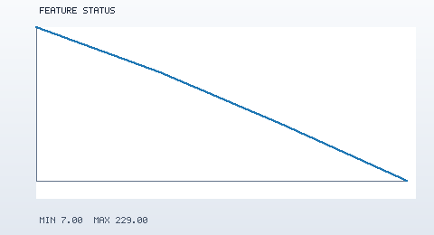

# OmniShield Status Report

This report was generated from the repository on 2026-11-21. Every number below comes from a live audit of the feature ledger, the component health check, the doctor suite and a measured prediction run.

## Executive summary

500 features are tracked. 393 have running code behind them (78.6%), of which 229 are implemented and 164 are partial. 88 need hardware or a service that is not in this repository, and 7 are refused because they have no testable definition. 37 of 37 components pass their checks.

## Coverage by group

| Group | Implemented | Partial | External | Refused |
|---|---|---|---|---|
| Digital Body | 9 | 16 | 0 | 0 |
| Memory System | 16 | 9 | 0 | 0 |
| Reasoning | 24 | 1 | 0 | 0 |
| Learning | 25 | 0 | 0 | 0 |
| Planning and Goals | 9 | 16 | 0 | 0 |
| Evolution and Genetics | 5 | 20 | 0 | 0 |
| Ethics and Values | 16 | 8 | 0 | 0 |
| Self-Awareness | 16 | 8 | 0 | 0 |



## Component health

| Layer | Component | Status |
|---|---|---|
| transport | P1 strict air-gap | pass |
| identity | P2 hardware-rooted identity | pass |
| transport | P3 ephemeral tunnel | pass |
| application | P4 deterministic allow-list | pass |
| crypto | Hybrid signatures | pass |
| runtime | ORGANISM core | pass |
| runtime | Durable memory | pass |
| runtime | Fail-closed guards | pass |
| integrity | Audit chain | pass |
| identity | Hardware binding | pass |
| meta | Gated self-modification | pass |
| cognition | Reasoning engines | pass |
| cognition | Planning engines | pass |
| introspection | Files and processes | pass |

## Prediction against reality

| Reading | Predicted | Observed | Error |
|---|---|---|---|
| load1 | 1.63 | 1.63 | 0.0 |
| memory_used_pct | 13.8 | 13.8 | 0.0 |

Mean absolute error was 0.0 with verdict 'close'. The prediction was made from 4 samples and then checked against the next real reading.

## How this report was made

```
omnishield doc report --out analysis/out
docx, xlsx, pptx and pdf are written directly by omnishield/docgen.py
```

## What is not claimed

- No consciousness, feelings or human equivalence.
- External features stay external until the hardware exists.
- Refused features stay refused; they are not relabelled.
